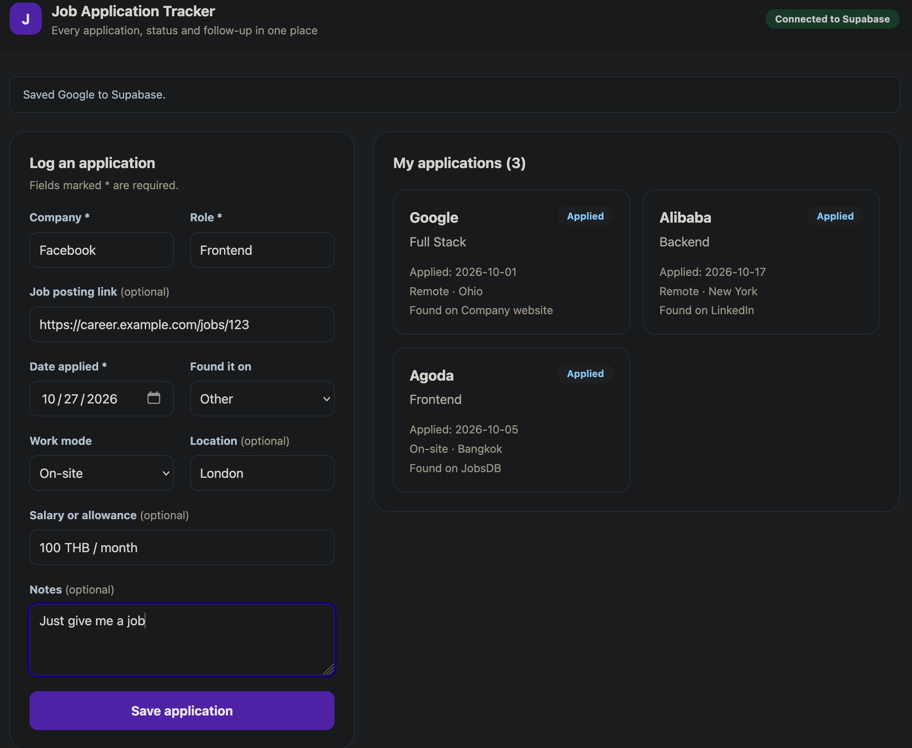
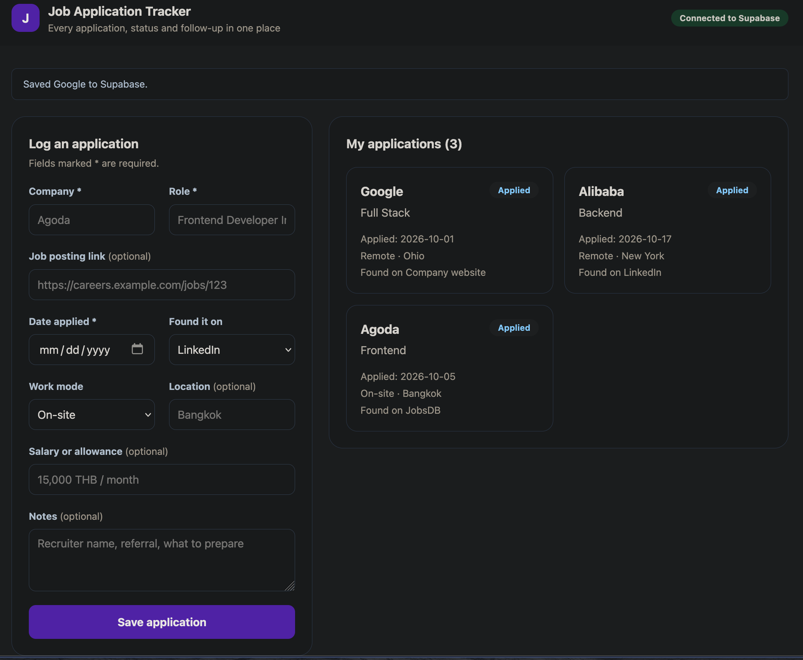
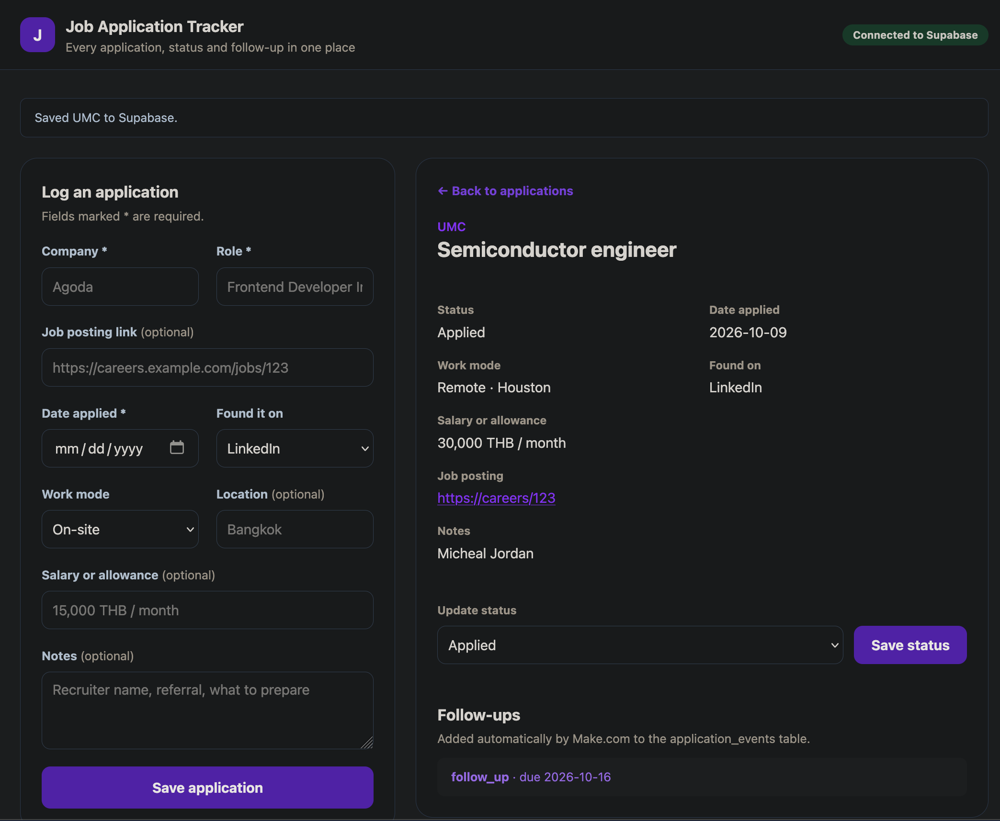
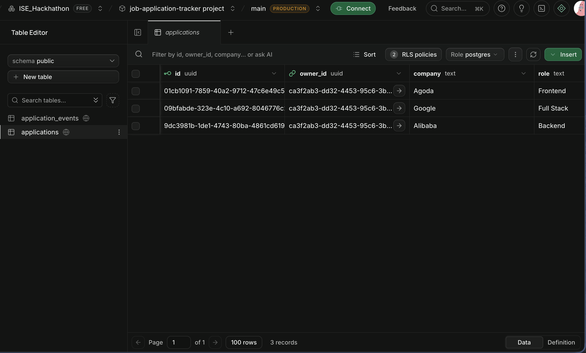
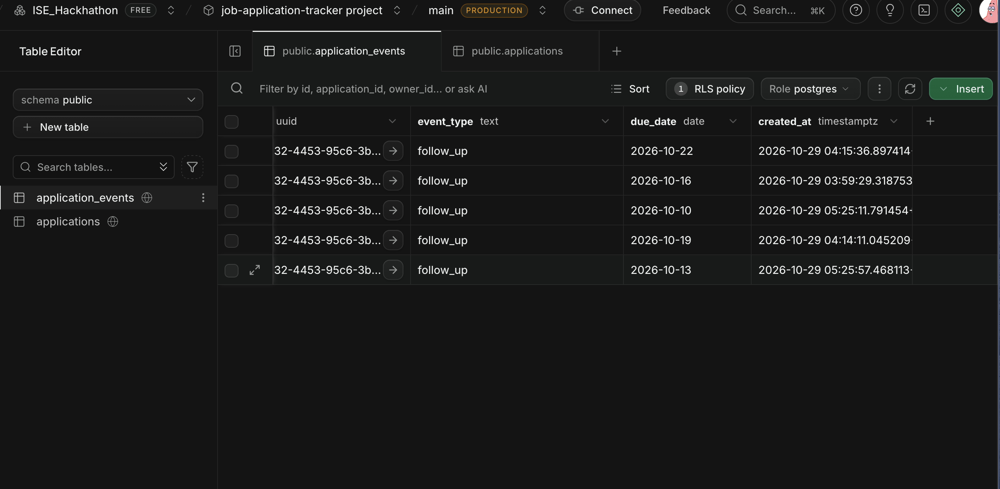
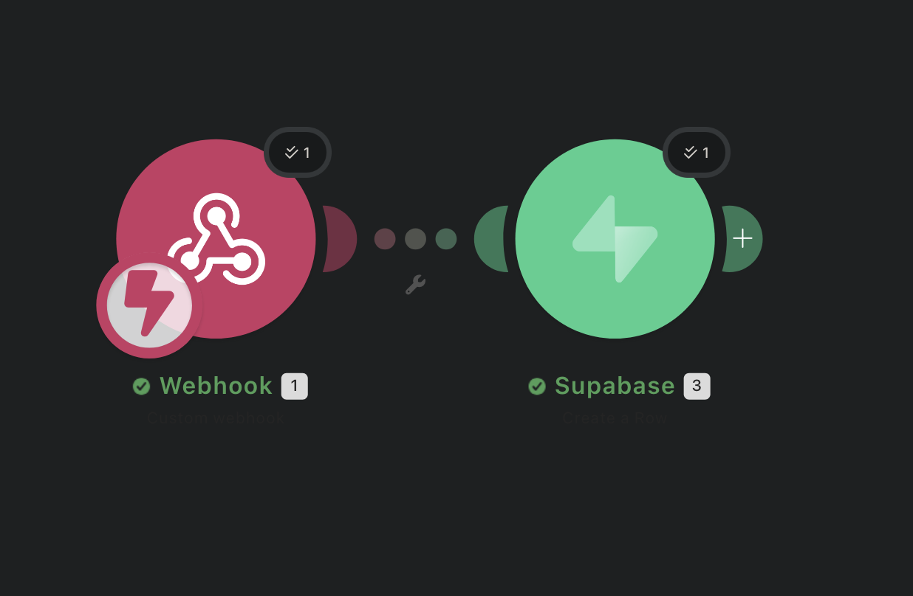
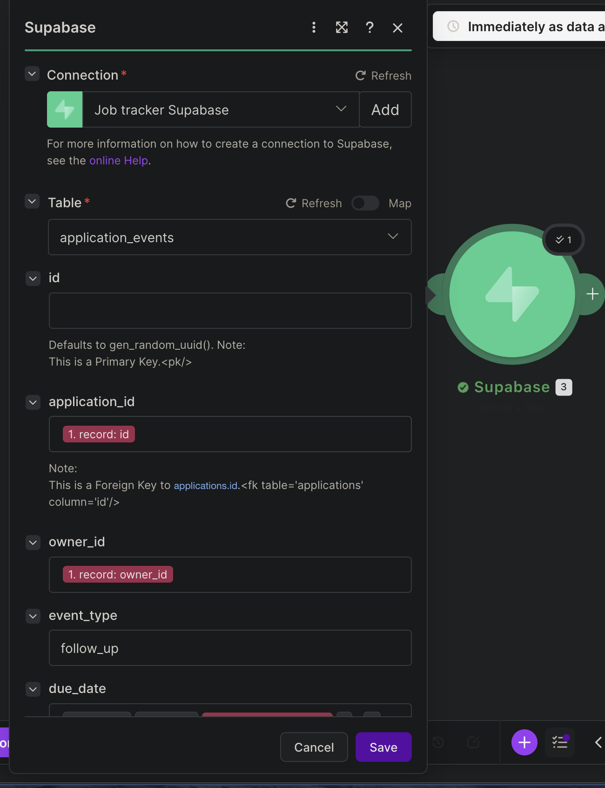
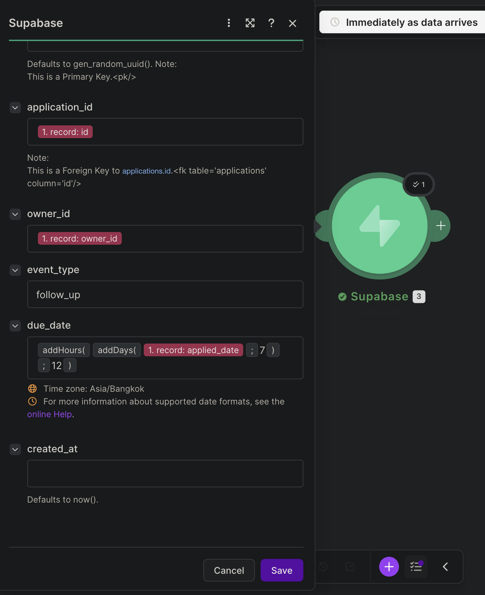

# Job Application Tracker

Track every job or internship you apply for, its status, and when to follow up.
Built with **Vue 3**, **Supabase** and **Make.com** for the ISE Vue Frontend Cloud Database Assignment.

## Features

- Log an application with a validated form (company, role, job link, date applied, where you found it, work mode, location, salary, notes).
- Every application is saved to Supabase and listed as a card, newest first.
- Open an application to see its details and update its status (Applied, Interview, Offer, Rejected).
- Each new application automatically gets a follow-up reminder from Make.com, due 7 days after the applied date.
- Works on desktop and mobile.
- Each browser signs in anonymously, and Row Level Security keeps each user's applications private.

## How the data flows

```
Vue form ──insert──▶ applications ──Database Webhook (INSERT)──▶ Make.com: Custom webhook
                                                                        │
Vue details ◀──select── application_events ◀── Make.com: Supabase Create a Row
```

## Database (Supabase)

| Table | Role |
|---|---|
| `applications` | Primary table: one row per job application, inserted by the Vue form. |
| `application_events` | Supporting table: follow-up events linked to an application by `application_id`. Filled by Make.com. |

Both tables and their Row Level Security policies are created on the Supabase website (SQL Editor and Table Editor), following the course's Supabase manual. They are not stored in this repository.

## Make.com automation

1. A Supabase **Database Webhook** on `applications` (event: Insert) sends each new row to a Make.com **Custom webhook**.
2. Make.com **Supabase → Create a Row** adds a row to `application_events`:
   - `application_id` = the new application's `id`
   - `owner_id` = the new application's `owner_id`
   - `event_type` = `follow_up`
   - `due_date` = applied date + 7 days
3. The follow-up appears under **Follow-ups** in the application's details view.

The Make.com connection uses the Supabase secret key, which stays inside Make.com and is never in this project.

## Screenshots

| | |
|---|---|
| Application form |  |
| Applications list from Supabase |  |
| Details with Make.com follow-up |  |
| Supabase `applications` table |  |
| Supabase `application_events` table |  |
| Make.com scenario |  |
| Make.com Create a Row: connection and table |  |
| Make.com Create a Row: field mapping |  |

## Run locally

1. Requires Node 22.18+ or 24.12+.
2. `npm install`
3. Copy `.env.example` to `.env.local` and add your Supabase project URL and publishable key.
4. On the Supabase website, create the `applications` and `application_events` tables and their policies, and turn on Authentication → Sign In / Providers → Allow anonymous sign-ins.
5. `npm run dev`

## Project structure

```
src/
  App.vue                            sign-in, Supabase reads / inserts / updates, page layout
  lib/supabase.js                    Supabase client (reads .env.local)
  components/ApplicationForm.vue     form and validation
  components/ApplicationList.vue     list of application cards
  components/ApplicationCard.vue     one application card
  components/ApplicationDetails.vue  details, status update, follow-ups
screenshots/                         screenshots for the submission
```

## Tech

Vue 3 (`<script setup>`), Vite, Tailwind CSS, `@supabase/supabase-js`, Supabase (Postgres, Row Level Security, Database Webhooks), Make.com.
